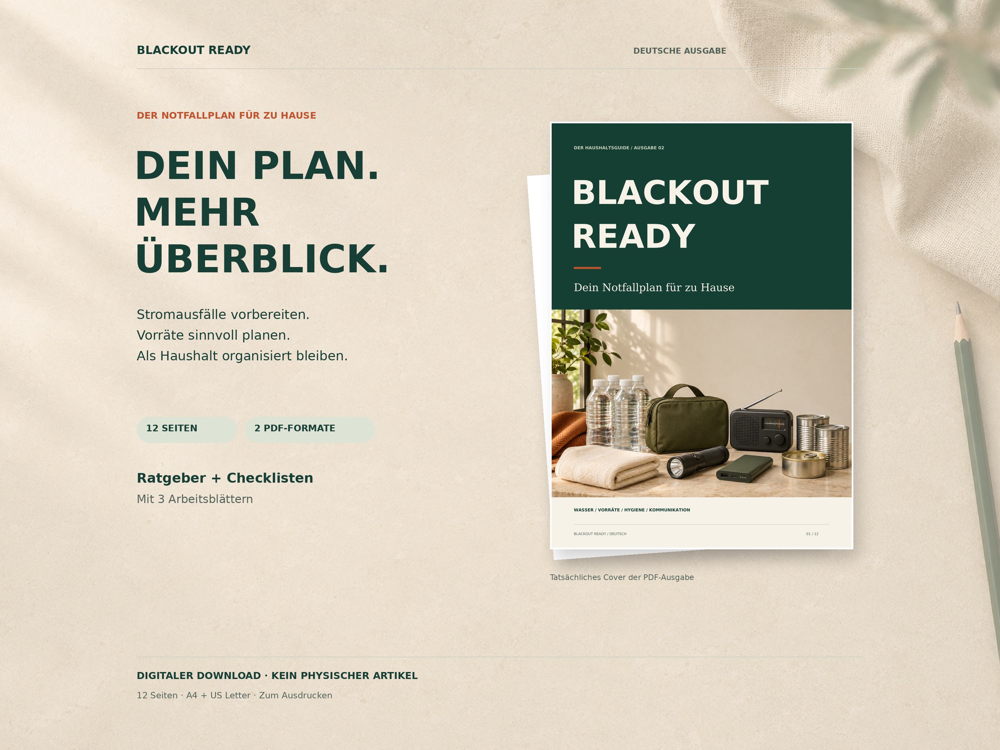

# BLACKOUT READY — Ausgabe 3

Bebilderter Haushaltsratgeber mit Checklisten und Arbeitsblättern auf Deutsch und Englisch.

## Download

[Komplettes Paket herunterladen](https://github.com/semihaksan90-ops/GPT/raw/refs/heads/main/Etsy-Blackout-Ready.zip)

Alternativ: **Code → Download ZIP**.

Enthalten:
- Deutsche und englische Ausgabe mit jeweils 12 Seiten in A4 und US Letter.
- Fotografischer Titel, drei neu erzeugte KI-Bildmotive und zweispaltige Kapitel.
- Inhaltsübersicht, Haushaltsplan, Vorratsliste und Praxistest.
- Zwölf Etsy-Produktbilder (je Sprache ein Hero und fünf weitere Motive), deutsche/englische Beschreibungstexte und bearbeitbare Quelldateien.

## Dateien für Käufer

Die Sprach-ZIPs im Ordner `etsy-blackout` enthalten ausschließlich die fertigen PDFs. Das komplette Paket enthält zusätzlich Material für den Shopbetreiber; Quelldateien und Verkäuferhinweise gehören nicht in den Kundendownload.

## Bearbeitung und Prüfung

`python etsy-blackout/build.py` erzeugt PDFs und Seitenvorschauen. `python etsy-blackout/package.py` erzeugt Etsy-Bilder und ZIP-Dateien. Benötigt Python, die Pakete aus `requirements.txt` und die im Generator angegebenen DejaVu-Schriftdateien.

Alle vier PDFs wurden auf Seitenzahl, Textgrenzen, Bildintegration und Quellenlinks geprüft; die ZIP-Integrität wurde kontrolliert. Beide Sprachfassungen wurden als Seitenübersicht visuell geprüft. Kein physischer Testdruck und keine aktuelle Prüfung der externen Quelleninhalte. Vor Veröffentlichung Sicherheitshinweise anhand aktueller offizieller Empfehlungen prüfen. Weitere Verkäuferhinweise: `etsy-blackout/Etsy-Texte.md`.

Die drei Bildmotive wurden mit KI erstellt. Noch keine Veröffentlichung auf Etsy.

## Neue Etsy-Bildsets

- [Deutsche Bilder als ZIP](https://github.com/semihaksan90-ops/GPT/raw/refs/heads/main/etsy-blackout/Etsy-Bilder-DE.zip)
- [Englische Bilder als ZIP](https://github.com/semihaksan90-ops/GPT/raw/refs/heads/main/etsy-blackout/Etsy-Bilder-EN.zip)

Jeweils 6 JPG-Dateien, 3000 × 2250 Pixel (4:3), nummeriert von 01_Hero bis 06_Lieferumfang. Die [Bildanleitung](etsy-blackout/Bilder-Anleitung.md) erläutert die Reihenfolge. Produktvisualisierungen verwenden tatsächliche PDF-Seiten und einen KI-generierten dekorativen Hintergrund.
