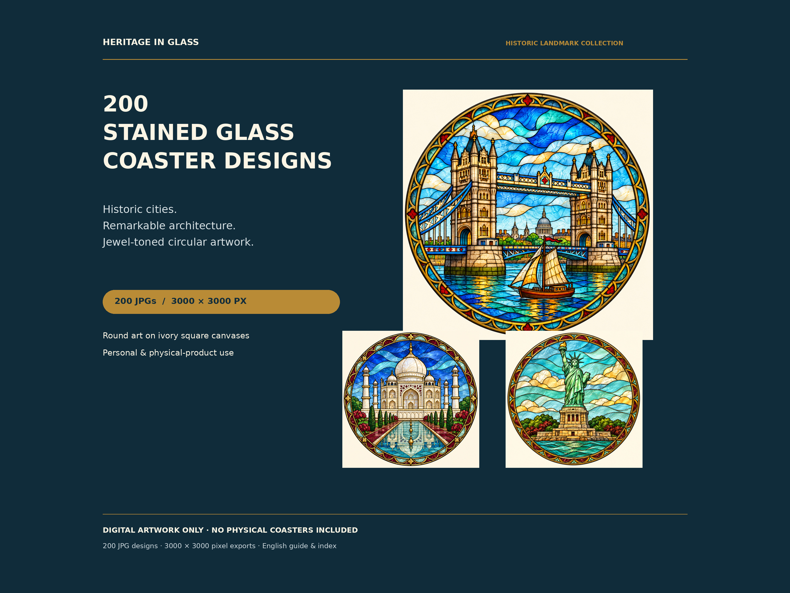

# Heritage in Glass

**200 Historic Cities & Landmarks — Stained-Glass-Style Coaster Art**

English-language digital artwork collection. The art is generated individually and exported as 200 different, numbered JPGs. Some cities have multiple different landmarks; this is not a claim of 200 separate cities.

## Downloads

Download all ten parts for the complete collection:

- [Part 01 — designs 001–020](https://github.com/semihaksan90-ops/GPT/raw/refs/heads/main/historical-stained-glass/downloads/Heritage-in-Glass-Part-01.zip)
- [Part 02 — designs 021–040](https://github.com/semihaksan90-ops/GPT/raw/refs/heads/main/historical-stained-glass/downloads/Heritage-in-Glass-Part-02.zip)
- [Part 03 — designs 041–060](https://github.com/semihaksan90-ops/GPT/raw/refs/heads/main/historical-stained-glass/downloads/Heritage-in-Glass-Part-03.zip)
- [Part 04 — designs 061–080](https://github.com/semihaksan90-ops/GPT/raw/refs/heads/main/historical-stained-glass/downloads/Heritage-in-Glass-Part-04.zip)
- [Part 05 — designs 081–100](https://github.com/semihaksan90-ops/GPT/raw/refs/heads/main/historical-stained-glass/downloads/Heritage-in-Glass-Part-05.zip)
- [Part 06 — designs 101–120](https://github.com/semihaksan90-ops/GPT/raw/refs/heads/main/historical-stained-glass/downloads/Heritage-in-Glass-Part-06.zip)
- [Part 07 — designs 121–140](https://github.com/semihaksan90-ops/GPT/raw/refs/heads/main/historical-stained-glass/downloads/Heritage-in-Glass-Part-07.zip)
- [Part 08 — designs 141–160](https://github.com/semihaksan90-ops/GPT/raw/refs/heads/main/historical-stained-glass/downloads/Heritage-in-Glass-Part-08.zip)
- [Part 09 — designs 161–180](https://github.com/semihaksan90-ops/GPT/raw/refs/heads/main/historical-stained-glass/downloads/Heritage-in-Glass-Part-09.zip)
- [Part 10 — designs 181–200](https://github.com/semihaksan90-ops/GPT/raw/refs/heads/main/historical-stained-glass/downloads/Heritage-in-Glass-Part-10.zip)

Part 01 also contains the Design Index, Design List, Read-Me and License. No JPG is repeated between parts.

[Seller Kit — six listing images, English listing text, buyer download guide and seller notes](https://github.com/semihaksan90-ops/GPT/raw/refs/heads/main/historical-stained-glass/Seller-Kit-EN.zip)

[View the Design Index](Design-Index.pdf)

## File specifications

- 200 JPG files, 3000 × 3000 pixel exports, RGB/sRGB.
- 300 DPI metadata; original generated dimensions are recorded in Design-List.csv. The export is digitally resized from the AI-generated original; it is not native vector or native 3000-pixel artwork.
- Circular artwork flattened onto an ivory square background; no transparency, SVG, PNG, editable layers or cutting paths.
- All designs are decorative interpretations, not exact architectural or historically verified reconstructions.
- No physical coasters are included. Physical print/sublimation results are not verified.

## Etsy delivery

The full-quality JPG archives are large. The prepared buyer-facing PDF provides links to the ten hosted parts; do not assume the ZIPs fit Etsy's direct attachment limits. Read SELLER-READ-ME.txt and verify the links before publishing. GitHub links are public downloads and do not provide buyer-only access control. You can replace them with your own appropriate permanent hosting URLs if required.

The included usage terms permit personal projects and physical end products for sale, prohibit redistribution of the digital files, and do not promise exclusivity or universal rights clearance. The English listing text includes AI disclosure.

## Rebuild and checks

After a fresh checkout, run `python restore-jpg.py` to restore the working JPG folder from the ten archive parts. Then `python build.py` and `python validate.py` can run.

The original generated PNGs remain in the cloud workspace; metadata records their paths locally. `export.py` creates the JPG exports. `build.py` creates the numbered catalog, ten ZIP archive parts, six Etsy images and buyer guide. `validate.py` checks the actual output counts, distinct hashes, file specifications, archive contents and PDF navigation.

Generated JPG working files are excluded from Git to avoid duplicating the large artwork archives. The ZIP parts contain the complete JPG product.

## Hosted download checks

All ten archive links were tested with small HTTPS range requests. Each returned a ZIP header and the hosted length matched the local archive. The buyer PDF links are pinned to the artwork commit. Results are recorded in `Remote-Download-Checks.json`.
